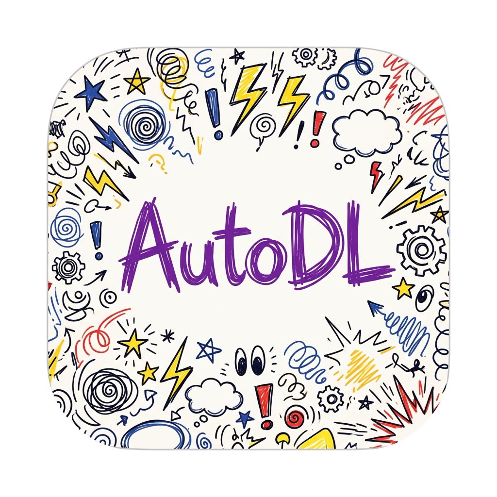
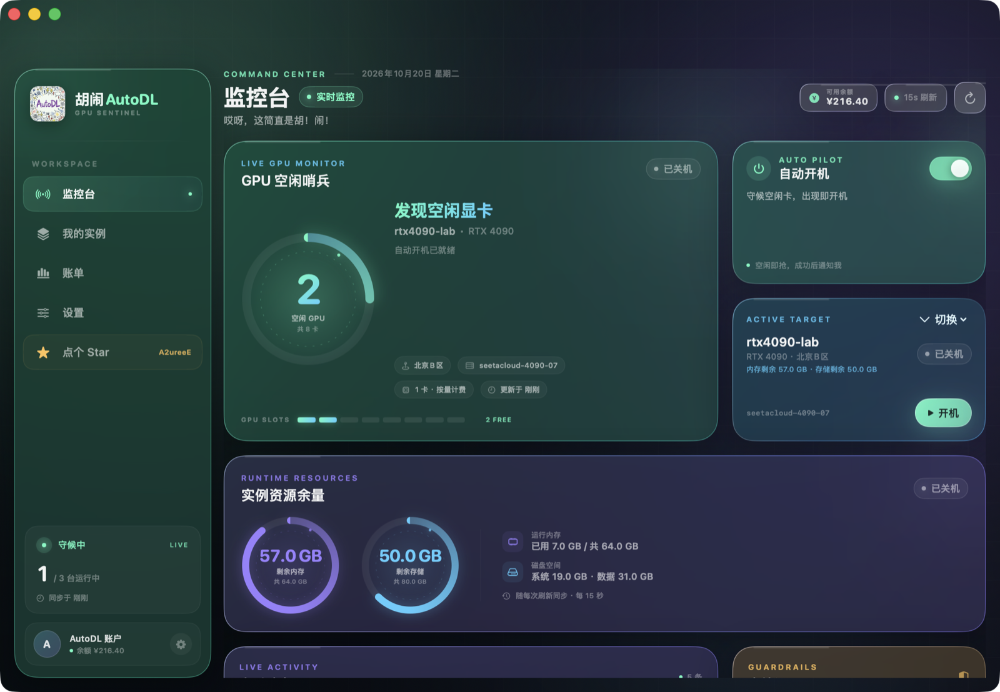
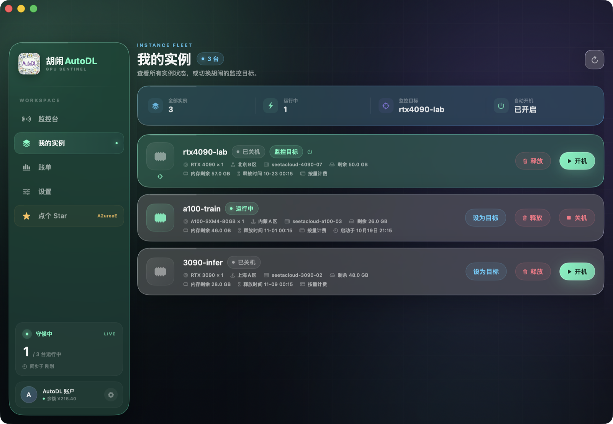
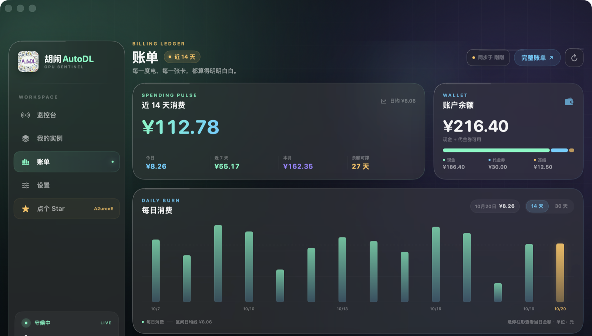
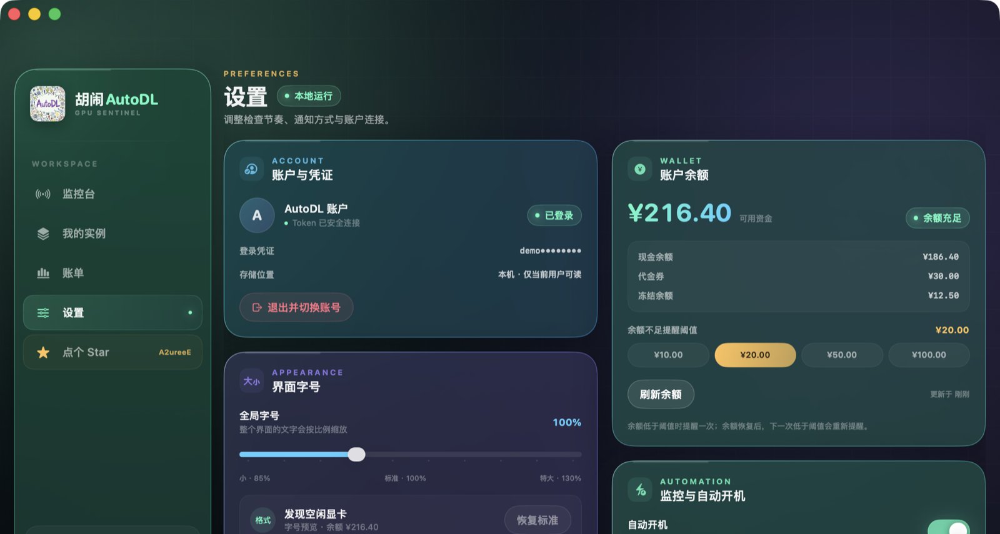

<p align="center">
  
</p>

<h1 align="center">胡闹AutoDL</h1>

<p align="center"><strong>哎呀，这简直是胡！闹！</strong></p>

<p align="center">一个原生 macOS 的 AutoDL 实例监控与自动开机工具。<br>盯住空闲显卡，出现即开机，顺便把余额、内存、存储和账单都整理明白。</p>

<p align="center">
  
  
  
  
</p>

---

## 胡闹什么

AutoDL 的闲置 GPU 就像食堂最后一份糖醋排骨：犹豫几秒，就没了。

胡闹AutoDL 是一个常驻菜单栏的 macOS 小工具。它会按你设定的节奏轮询目标实例所在的 GPU 池，一旦发现空闲显卡，立刻通知你，或者直接帮你把实例开机。没有网页标签页，没有反复刷新，也没有 Keychain 密码弹窗。

- **原生 SwiftUI**：不是 Electron，不套壳，启动快、占用低。
- **Liquid Glass 界面**：深色极光背景、玻璃卡片与柔和光效，支持全局字号缩放。
- **本地优先**：Token 只保存在本机，所有数据只在你的 Mac 与 AutoDL 之间流动。
- **测试数据模式**：内置 `--demo` 参数，不联网也能预览完整界面。

## 界面预览

> 以下截图均使用内置演示数据生成，不包含任何真实账户信息。

### 监控台

实时显示空闲 GPU 数量、当前监控目标、实例资源余量（剩余内存、剩余存储）、账户余额与自动开机状态。



### 我的实例

集中查看所有实例的 GPU 型号、区域、配置、运行状态、剩余内存、剩余存储与释放时间，支持开机、关机与前往网页释放。



### 账单看板

按天统计近 35 天消费，支持 14 天 / 30 天切换的柱状图、悬停查看当日明细、消费构成与近期流水，余额与代金券一目了然。



### 设置

管理账户连接、余额提醒阈值、全局字号、检查频率与通知权限。



## 功能

| 能力 | 说明 |
| --- | --- |
| GPU 空闲哨兵 | 轮询目标主机所在 GPU 池，展示空闲卡数量与槽位分布 |
| 自动开机 | 发现空闲 GPU 后可自动开机，失败与成功都会留下记录 |
| 手动开关机 | 在实例列表中直接开机或关机，无需打开浏览器 |
| 释放时间 | 展示实例最早的有效释放时间，完整时间与倒计时可在提示中查看 |
| 资源余量 | 监控台用圆形仪表盘展示剩余内存与剩余存储 |
| 余额监控 | 查询现金、冻结金额与代金券；低于阈值时只提醒一次 |
| 账单看板 | 35 天账单同步、日消费柱状图、消费构成与流水明细 |
| 菜单栏速览 | 点击菜单栏图标即可查看状态、切换目标、控制自动开机 |
| 原生通知 | 空闲卡、自动开机结果、余额不足与测试通知 |
| 内嵌登录 | 在应用内完成 AutoDL 登录，自动捕获 Token，无需手动复制 |
| 本地 Token | 写入 `0600` 权限文件，不触发 Keychain 弹窗 |
| 演示模式 | `--demo` 启动参数，使用内置数据离线展示界面 |

## 系统要求

- macOS 15 Sequoia 或更高版本
- Apple Silicon（arm64）
- Xcode Command Line Tools（提供 `swiftc`、`codesign` 等命令）

> 当前构建脚本只产出 arm64 应用，不提供 Intel 版本。

## 构建与运行

```bash
git clone https://github.com/A2ureeE/CrazyAutoDL.git
cd CrazyAutoDL

# 编译、打包并 ad-hoc 签名
./HuNaoAutoDL/scripts/build-app.sh

# 运行
open "dist/胡闹AutoDL.app"
```

安装到「应用程序」：

```bash
cp -R "dist/胡闹AutoDL.app" /Applications/
open "/Applications/胡闹AutoDL.app"
```

构建脚本会把所有 Swift 源文件编译为单一可执行文件，复制图标与 `Info.plist`，在临时目录完成签名后再输出到 `dist/`。首次启动时，如果 macOS 提示无法验证开发者，可在 Finder 中右键应用并选择「打开」。

## 使用

### 1. 登录并连接账户

首次启动会展示登录页。点击登录后，应用会打开 AutoDL 官方登录页面，登录成功后会从登录响应中自动提取 Token 并保存。整个过程不需要手动查找或粘贴 Token。

也可以切换到手动输入，直接填写已有 Token。退出账户时，本地 Token 会被删除，监控随即停止。

### 2. 选择监控目标

进入「我的实例」，在实例卡片右侧点击「监控此实例」。监控台会围绕该实例所在的主机与 GPU 池工作。

### 3. 打开自动开机

在监控台右侧的「自动开机」卡片中开启开关。之后只要目标 GPU 池出现空闲卡，应用就会尝试开机，并发送本地通知。

- 默认每 15 秒检查一次，可在设置中调整为 10 / 15 / 30 / 60 秒。
- 自动开机失败后，会等待 60 秒再重试，避免连续请求接口。
- 关闭自动开机时，发现空闲卡仍会提醒，但不会自动操作。

### 4. 管理实例

实例卡片提供开机、关机与「释放」按钮。

「释放」不会在应用内直接执行，而是打开 AutoDL 控制台的实例列表，由你在网页中手动确认。释放会销毁实例和数据，这个确认步骤必须留给你自己。

### 5. 查看账单

进入「账单」即可同步最近 35 天的消费记录。可按 14 天或 30 天查看柱状图，鼠标悬停柱子会显示当日消费、原价与优惠。账单缓存 120 秒，窗口重新激活时可手动刷新。

### 6. 菜单栏速览

点击菜单栏中的胡闹图标，会弹出一个快捷面板：

- 查看当前监控状态与上次更新时间
- 快速切换监控目标
- 开关自动开机
- 打开主窗口或刷新数据

关闭主窗口后应用仍会在菜单栏运行，自动开机监控不会中断。

## 数据与隐私

- Token 保存在 `~/Library/Application Support/HuNaoAutoDL/session.token`，文件权限 `0600`，目录权限 `0700`，并标记为不参与备份。
- 不使用 Keychain，因此不会反复弹出系统密码框。
- 应用只向 `https://www.autodl.com` 发起请求，不经过任何第三方服务器。
- 通知由 macOS 本地 `UserNotifications` 框架发送，不上传设备信息。
- `--demo` 演示模式使用内置数据，不发起网络请求，也不会读写你的 Token。

## 技术说明

### AutoDL 接口

应用使用 AutoDL 网页端接口：

| 用途 | 接口 |
| --- | --- |
| 实例列表 | `POST /api/v1/instance` |
| 主机与 GPU 池 | `POST /api/v1/user/machine/list` |
| 开机 | `POST /api/v1/instance/power_on` |
| 关机 | `POST /api/v1/instance/power_off` |
| 钱包余额 | `GET /api/v1/wallet` |
| 账单流水 | `POST /api/v1/bill/list` |

这些接口并非 AutoDL 官方公开 API，字段可能随网页端更新而变化。应用在解析失败时会保留上一次数据并给出错误提示。

### 一些实现细节

- **释放时间**：优先读取 `rent_deadline` 与 `expired_at`，取其中最早的有效时间；`timed_shutdown_at` 属于定时关机，不作为释放时间。列表显示 `MM-dd HH:mm`，悬停可查看完整日期与剩余天数。
- **账单金额**：接口以千分之一元为单位返回，展示时统一除以 1000。
- **账单范围**：默认拉取最近 35 天，按 `Asia/Shanghai` 划分自然日；每页 500 条，最多翻 6 页并按记录 ID 去重。
- **轮询范围**：8–120 秒，默认 15 秒；设置页提供 10 / 15 / 30 / 60 秒快捷选项。
- **自动开机冷却**：两次自动开机尝试之间至少间隔 60 秒。
- **账单缓存**：120 秒内重复进入账单页不会重新请求。

### 演示模式

```bash
# 监控台
open -n "dist/胡闹AutoDL.app" --args --demo

# 指定页面：dashboard / instances / billing / settings
open -n "dist/胡闹AutoDL.app" --args --demo --section=billing
```

演示模式包含三个虚构实例、GPU 池余量、账户余额与 35 天账单，适合截图、录屏或界面开发。

### 项目结构

```text
CrazyAutoDL/
├── HuNaoAutoDL/
│   ├── Info.plist
│   ├── Resources/            # 应用图标
│   ├── Sources/
│   │   ├── AutoDLAPI.swift   # AutoDL 接口封装
│   │   ├── AppModel.swift    # 状态、轮询与自动开机
│   │   ├── Models.swift      # 实例、余额、账单模型
│   │   ├── DemoData.swift    # 演示数据
│   │   ├── TokenStore.swift  # 本地 Token 存储
│   │   ├── LoginWebView.swift
│   │   ├── NotificationService.swift
│   │   ├── MenuBarController.swift
│   │   └── Views/            # 监控台、实例、账单、设置、快捷面板
│   └── scripts/build-app.sh
├── docs/images/              # README 截图
└── README.md
```

## 常见问题

**为什么点击「释放」打开的是网页？**

释放会永久销毁实例与磁盘数据，属于不可撤销操作，因此应用不做二次确认式的直接调用，而是把你带到 AutoDL 官方控制台完成确认。

**为什么实例没有显示释放时间？**

只有接口返回了有效的 `rent_deadline` 或 `expired_at` 才会展示。新建实例、按量计费实例或接口字段缺失时会显示「待同步」，刷新后会自动补齐。

**为什么收不到通知？**

请先在「设置」中允许通知，并确认应用仍在运行。macOS 的「系统设置 → 通知 → 胡闹AutoDL」中也需要允许横幅。自动开机成功、自动开机失败、发现空闲卡与余额不足都会尝试发送通知。

**会自动释放实例吗？**

不会。应用只会开机、关机，以及跳转网页让你手动释放。任何销毁数据的操作都需要你本人在 AutoDL 控制台确认。

**Token 会被上传吗？**

不会。Token 只写入本地文件，请求直接发往 AutoDL。仓库中不包含任何凭证，演示模式也不读取真实 Token。

**为什么没有 Intel 版本？**

构建脚本固定为 `arm64-apple-macosx15.0`。如需 Intel 版本，需要自行修改脚本中的 target 并重新编译，目前未做兼容性验证。

**使用这个工具会导致封号吗？**

应用以接近网页端的频率访问接口，默认 15 秒一次。仍建议不要设置过低频率或同时运行多个监控工具。这是非官方工具，使用风险需自行承担。

## 作者

由 [A2ureeE](https://github.com/A2ureeE) 用胡闹的方式写出来。

如果它帮你抢到过一张显卡，欢迎去仓库点个 Star：

<p align="center">
  <a href="https://github.com/A2ureeE/CrazyAutoDL">
    
  </a>
</p>

## 免责声明

胡闹AutoDL 是第三方本地工具，与 AutoDL 官方无隶属关系。应用通过网页端接口读取数据并执行开关机操作，接口变更可能导致功能失效。请遵守 AutoDL 服务条款，并自行承担使用风险。
